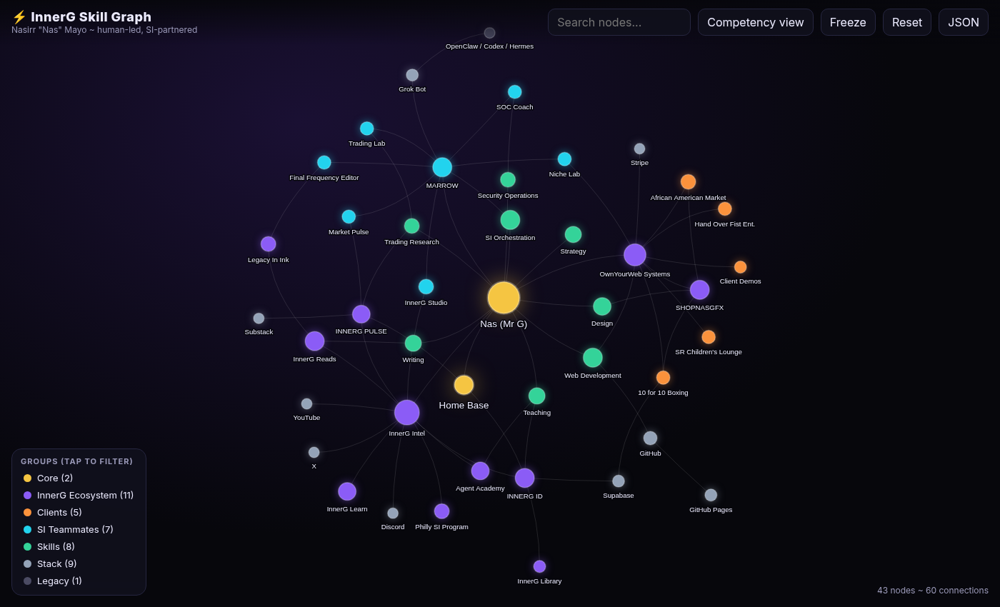

# InnerG Skill Graph

**Live Visualization:** https://innergclaw.github.io/innerg-skill-graph/

An interactive knowledge network visualization for tracking skills, projects, tools, and relationships.



---

## What This Is

A **force-directed graph** showing how your capabilities connect:
- **Identity** (Pink) — Core self, goals, philosophy
- **Skills** (Blue) — What you can do
- **Projects** (Green) — What you're building
- **Tools** (Yellow) — Software/stack you use
- **Clients** (Orange) — Business relationships

**The lines** = relationships between nodes. Click any node to see its connections.

---

## How to Customize

### 1. Edit the Data

Open `index.html` and find the `graphData` object (around line 90).

```javascript
const graphData = {
  nodes: [
    // Add your nodes here
    { id: 'unique-id', label: 'Display Name', group: 'skill', size: 30, title: 'Tooltip text' },
  ],
  edges: [
    // Add connections here
    { from: 'node-a', to: 'node-b', label: 'relationship type' },
  ]
};
```

### 2. Node Properties

| Property | Required | Description |
|----------|----------|-------------|
| `id` | ✅ | Unique identifier (no spaces) |
| `label` | ✅ | Display name on graph |
| `group` | ✅ | `identity`, `skill`, `project`, `tool`, `client` |
| `size` | ✅ | Node size (15-50 recommended) |
| `title` | ❌ | Tooltip text on hover |

### 3. Groups & Colors

| Group | Color | Use For |
|-------|-------|---------|
| `identity` | 🩷 Pink | Self, goals, philosophy |
| `skill` | 🔵 Blue | Capabilities, expertise |
| `project` | 🟢 Green | Active work, businesses |
| `tool` | 🟡 Yellow | Software, platforms |
| `client` | 🟠 Orange | Customers, demos |

### 4. Example: Adding a New Project

```javascript
// Add to nodes array
{ id: 'new-app', label: 'My New App', group: 'project', size: 30, title: 'SaaS product' },

// Add to edges array to connect it to skills
{ from: 'new-app', to: 'web-dev', label: 'built with' },
{ from: 'new-app', to: 'strategy', label: 'planned' },
```

---

## Features

- **Interactive** — Drag nodes, zoom, pan
- **Click nodes** — See connection details in side panel
- **Physics toggle** — Freeze/unfreeze the layout
- **Export JSON** — Download your data
- **Responsive** — Works on mobile

---

## Keyboard Shortcuts

| Action | Key |
|--------|-----|
| Reset view | Click "Reset View" button |
| Toggle physics | Click "Toggle Physics" button |
| Export data | Click "Export JSON" button |

---

## Updating Your Graph

1. Edit `index.html` with new nodes/edges
2. Commit changes: `git add . && git commit -m "Update graph"`
3. Push: `git push origin main`
4. Changes live in ~1 minute at your GitHub Pages URL

---

## Use Cases

- **Self-awareness** — See your skill network
- **Portfolio** — Show clients your capabilities
- **Planning** — Identify gaps or clusters
- **Branding** — Visual "about me" page

---

## Built With

- [Vis.js](https://visjs.org/) — Network visualization
- GitHub Pages — Hosting
- Pure HTML/CSS/JS — No build step

---

## License

Free to use, modify, and share.
